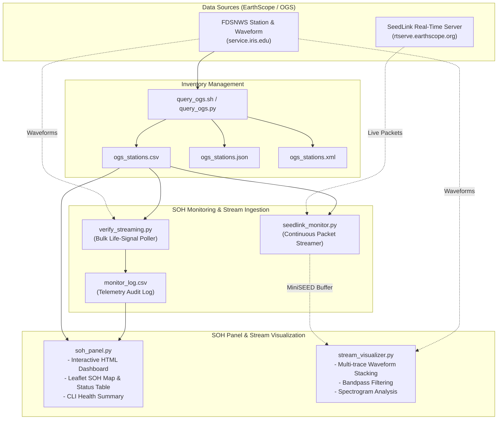

# Oklahoma Seismic Network State of Health & Stream Visualization

A real-time monitoring and visualization platform for Oklahoma Seismic Network **State of Health (SOH)** and continuous waveform data streaming. Built primarily for the **Oklahoma Geological Survey (OGS)** networks (`OK` and `O2`), with full compatibility across any **EarthScope / FDSN** and **SeedLink** compliant seismic network.

---

## 📌 Project Objectives & Scope

This project focuses on operational network telemetry monitoring, life-signal auditing, and real-time seismic waveform visualization:

- **Station Life Signal & Health Auditing (SOH)**:
  - Continuously track data latency (packet arrival delay against real-time UTC).
  - Classify station telemetry status in real time:
    - 🟢 **ONLINE**: Low latency ($\le 30\,\text{s}$).
    - 🟡 **DELAYED**: Telemetry lag ($> 30\,\text{s}$).
    - 🔴 **OFFLINE**: No recent packets or communication dropout.
  - Maintain persistent telemetry logs (`monitor_log.csv`) for uptime analytics, gap analysis, and network performance reports.

- **Real-Time Stream Ingestion**:
  - Ingest live miniSEED data packets via the **SeedLink** protocol (`rtserve.earthscope.org`) for instantaneous packet-by-packet latency tracking.
  - Perform scheduled array-wide health audits using **FDSNWS Dataselect** bulk waveform polling.

- **Interactive SOH Panel (Dashboard)**:
  - Unified interactive dashboard (`soh_panel.py`) displaying network health statistics, active station counts, and latency distributions.
  - Geospatial mapping of station status across Oklahoma and surrounding regions with live status pins.
  - Outage identification, searchable station roster, and CLI status summaries.

- **Stream Waveform Visualization**:
  - Dedicated stream visualizer (`stream_visualizer.py`) for multi-station, multi-channel live waveform displays.
  - Stacked waveform traces, 3-component views, and time-frequency spectrogram analysis.
  - Signal conditioning tools: detrending, cosine tapering, and customizable bandpass filtering.

---

## 🏗️ System Architecture



---

## 🗂 Project Structure

```text
.
├── README.md               # Project documentation and quickstart guide
├── AGENT_KNOWLEDGE.md      # AI agent guide, technical rules, and gotchas
├── requirements.txt        # Python package dependencies
├── run_workflow.sh         # Master workflow orchestrator (audit, dashboard, visualization)
│
├── query_ogs.sh            # Automated Bash wrapper to harvest OGS station inventories
├── query_ogs.py            # FDSNWS client for querying active/all station metadata
│
├── verify_streaming.py     # Periodic array-wide SOH monitor and latency logger
├── seedlink_monitor.py     # Real-time SeedLink streaming client and buffer
│
├── soh_panel.py            # Interactive SOH Panel & Dashboard generator (HTML & CLI)
├── stream_visualizer.py    # Multi-station waveform stream visualizer & spectrogram plotter
│
├── ogs_stations.csv        # Flattened active station metadata (coords, elevation, dates)
├── ogs_stations.json       # JSON-formatted station inventory
├── ogs_stations.xml        # Standard StationXML metadata
├── monitor_log.csv         # Persistent historical latency & status log
│
└── legacy/                 # Preserved exploratory scripts
    ├── README.md           # Legacy reference guide
    ├── test_seisbench.py   # Baseline model verification
    └── seisbench_tutorial.py # Sample continuous PhaseNet annotation
```

---

## ⚙️ Installation & Setup

### 1. Prerequisites & Environment

Using Python 3.10+ in a virtual environment or Conda:

```bash
# Using Conda
conda activate TL   # or your designated seismic environment

# Or using venv
python3 -m venv .venv
source .venv/bin/activate
```

### 2. Install Dependencies

Install the core seismic processing and data analysis packages:

```bash
pip install -r requirements.txt
```

Core libraries:
- **ObsPy**: FDSN client, SeedLink client, MiniSEED processing, seismic signal analysis.
- **Pandas**: Telemetry log aggregation and metrics analysis.
- **Matplotlib**: Waveform plotting and spectral visualizations.
- **Requests**: Network and web service communication.

---

## 🚀 Quickstart & Usage

### ⚡ One-Command Master Workflow (Recommended)

Run the full end-to-end pipeline (station check, real-time SOH audit, interactive HTML dashboard generation, and live waveform stream visualization):

```bash
# Run complete end-to-end workflow
./run_workflow.sh

# Run workflow and immediately serve the web dashboard locally
./run_workflow.sh --serve

# Run continuous 30-second monitoring loop
./run_workflow.sh --monitor 30
```

---

### 1. Harvest Active Station Metadata

Fetch the latest inventory of active OGS stations (`OK` and `O2` networks) from EarthScope FDSNWS:

```bash
# Query active stations and generate CSV, JSON, and StationXML
./query_ogs.sh csv json xml

# Or fetch complete historical inventory (including retired stations)
./query_ogs.sh csv --all
```

Outputs `ogs_stations.csv`, `ogs_stations.json`, and `ogs_stations.xml`.

---

### 2. Run the Real-Time SOH Life-Signal Monitor

Audit packet latency across all active stations using bulk FDSN waveform polling:

```bash
# Single audit snapshot (checks data arriving within the last 60 seconds)
python3 verify_streaming.py --csv ogs_stations.csv --window 60

# Continuous monitoring loop (refreshes every 30 seconds)
python3 verify_streaming.py --csv ogs_stations.csv --window 60 --loop 30
```

**Console Output:**
```text
=========================================================
 📡 OKLAHOMA SEISMIC NETWORK REAL-TIME LIFE SIGNAL MONITOR
 Time: 2026-10-03 17:30:00 UTC | Window: Last 60s
=========================================================
 🟢 ONLINE  (<30s latency) : 124
 🟡 DELAYED (>30s latency) : 18
 🔴 OFFLINE (No recent data): 11
 📈 Availability Rate      : 92.5%
 💾 Log Appended           : monitor_log.csv
=========================================================
```

---

### 3. Generate and View the SOH Panel Dashboard

Generate an interactive, standalone HTML dashboard with live status cards, an interactive Leaflet map, and a searchable station roster:

```bash
# Generate the dashboard HTML
python3 soh_panel.py --html soh_dashboard.html

# Perform a fresh audit and launch local web server
python3 soh_panel.py --audit --serve --port 8050

# Quick terminal health summary
python3 soh_panel.py --cli
```

---

### 4. Visualize Waveform Streams

Fetch and visualize multi-station seismic waveforms or spectrograms in real time:

```bash
# Stacked multi-station waveform plot (last 60 seconds, 1-10 Hz bandpass filter)
python3 stream_visualizer.py --stations OK.CHOK,OK.BLOK,OK.SMO --duration 60 --filter 1.0,10.0 --output waveforms.png

# Time-frequency spectrogram for a single station
python3 stream_visualizer.py --stations OK.CHOK --duration 120 --spectrogram --output spectrogram.png

# Visualize from a locally recorded MiniSEED buffer
python3 stream_visualizer.py --source mseed --file stream_buffer.mseed --output waveforms.png
```

---

### 5. Stream Live Packets via SeedLink

Stream real-time miniSEED packets directly from EarthScope's SeedLink server (`rtserve.earthscope.org`):

```bash
# Listen to live packets and display instant latency
python3 seedlink_monitor.py

# Filter specific stations and record stream buffer
python3 seedlink_monitor.py --stations U32A,CCO2,CAL1 --record stream_buffer.mseed
```

---

## 📊 SOH Metrics & Health Classification

| Status | Latency Range | Indicator | Description |
| :--- | :--- | :---: | :--- |
| **Online** | $\le 30\,\text{seconds}$ | 🟢 | Telemetry stream is healthy, low-latency, and uninterrupted. |
| **Delayed** | $> 30\,\text{seconds}$ | 🟡 | Telemetry stream is lagging due to buffer hold-up or cellular link delays. |
| **Offline** | No data / Timeout | 🔴 | No packets received in current window. Station may be down, powered off, or disconnected. |

---

## 📚 References & Data Sources

- **Oklahoma Geological Survey (OGS)**: [ou.edu/ogs](https://www.ou.edu/ogs)
- **EarthScope Data Management Center**: [service.iris.edu](https://service.iris.edu)
- **ObsPy Documentation**: [docs.obspy.org](https://docs.obspy.org)
- **SeedLink Protocol**: [IRIS SeedLink Guide](https://ds.iris.edu/ds/nodes/dmc/services/seedlink/)
